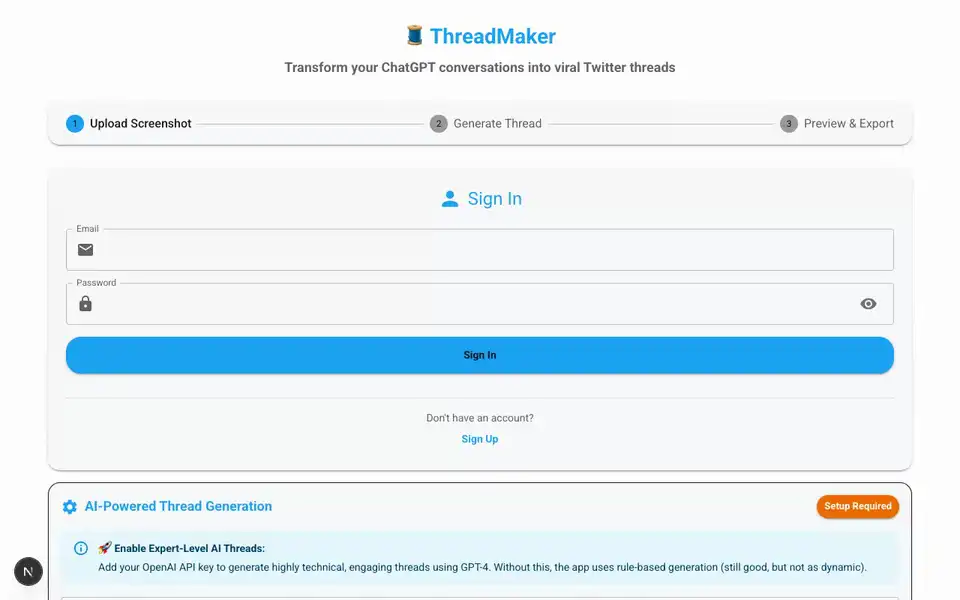
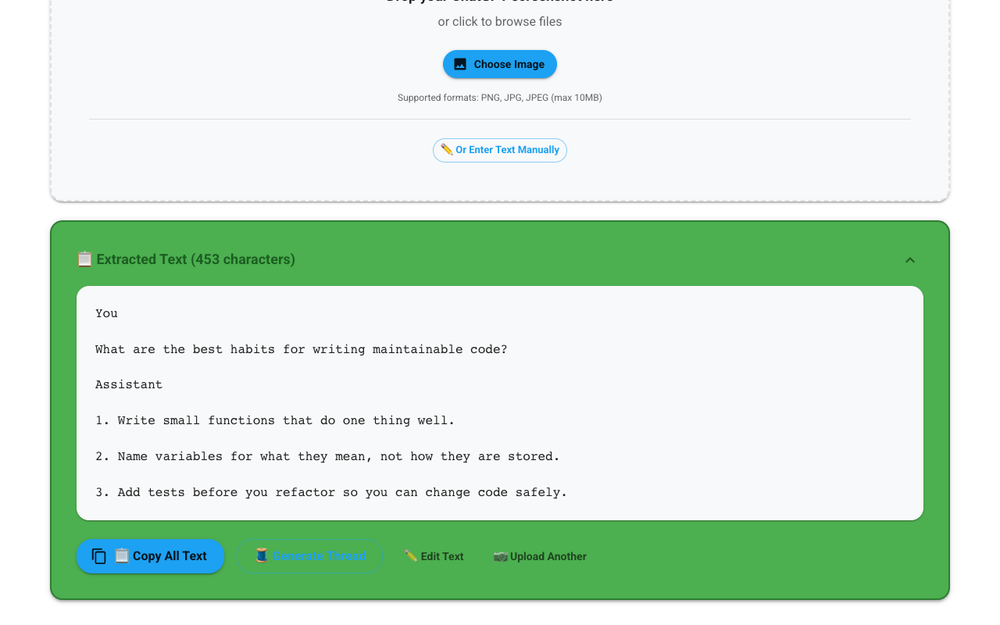
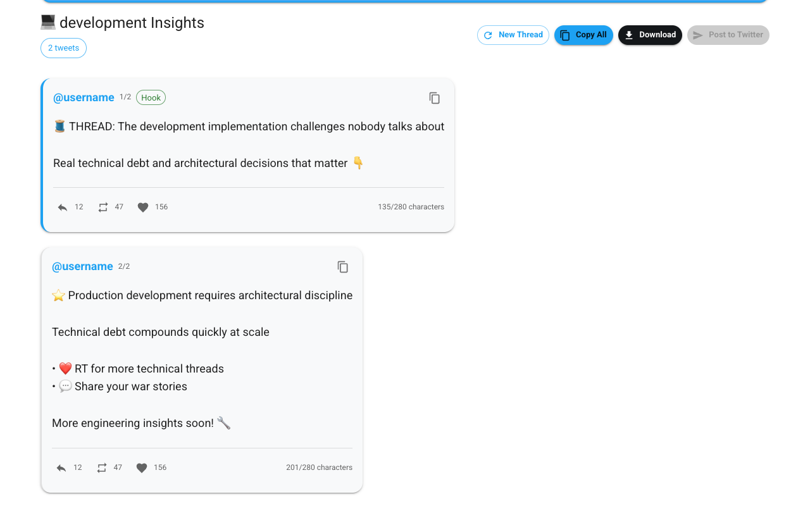
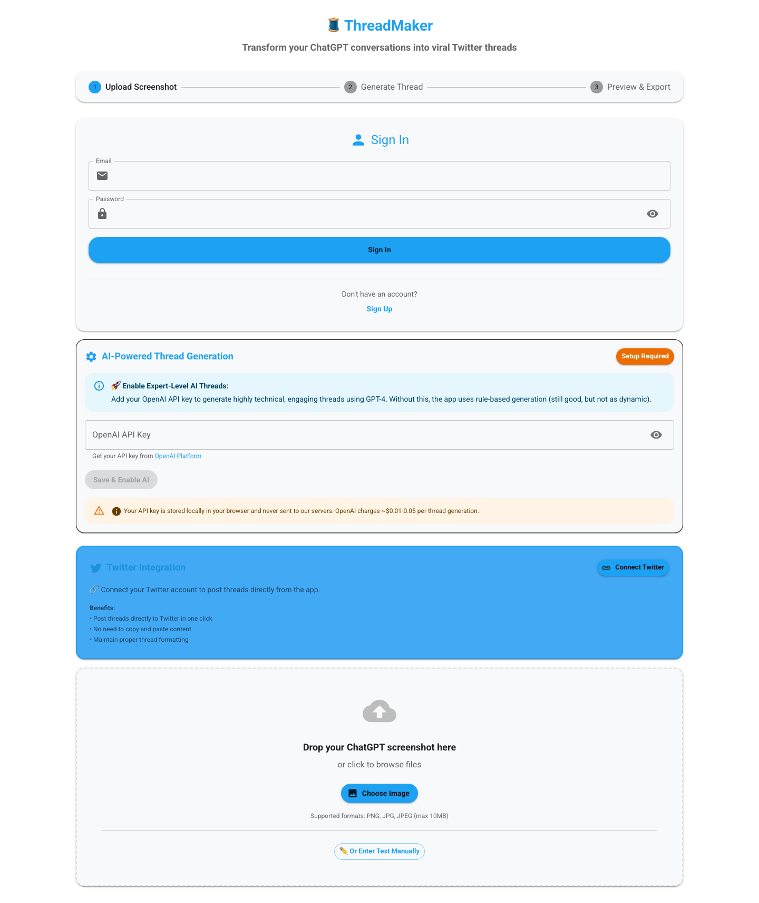

<div align="center">

# 🧵 ThreadMaker

**Turn a ChatGPT screenshot into a ready-to-post Twitter thread.** OCR runs in your browser, an AI (or a rule-based fallback) writes the thread, and you copy, download or post it.


<br /><br />



<sub>Recorded locally with <code>npm run dev</code> and no OpenAI key, so the thread comes from the rule-based generator. The input is a synthetic sample chat. The browser ran with CSP bypassed so OCR could load; see <a href="#known-issues">Known issues</a>.</sub>

</div>

---

## From screenshot to thread in three steps

The app has a three-step flow: **Upload Screenshot → Generate Thread → Preview & Export**.

1. **Upload a screenshot:** drag and drop, or click to upload a screenshot of your ChatGPT conversation (PNG, JPG or JPEG, up to 10 MB). Or choose **Or Enter Text Manually**.
2. **OCR:** Tesseract.js reads the text in your browser and shows progress. You can copy or edit the extracted text before going on.
3. **Generate the thread:** click **Generate Thread**. With an OpenAI key, `gpt-4o-mini` writes it; without one, a rule-based generator does.
4. **Preview and edit:** review the thread in Twitter-style cards, with a character count against the 280 limit for each tweet.
5. **Export:** copy one tweet or the whole thread, download it, or post it directly once Twitter is connected.

<table>
  <tr>
    <td width="50%" valign="top">
      
      <br /><sub><b>OCR result.</b> The text is extracted in the browser and can be copied, edited or turned into a thread.</sub>
    </td>
    <td width="50%" valign="top">
      
      <br /><sub><b>Thread preview.</b> A hook tweet, per-tweet character counts and export actions. The reply, retweet and like counts are hard-coded placeholders in the preview.</sub>
    </td>
  </tr>
</table>

<details>
<summary><b>The full page: sign in, AI configuration, Twitter connection and upload</b></summary>
<br />

</details>

## What it does

- **📸 OCR in the browser:** upload screenshots and extract text with Tesseract.js. Retries up to twice.
- **🤖 AI thread writing:** OpenAI (`gpt-4o-mini` in `src/lib/threadGenerator.ts`) writes technical threads tuned for engagement.
- **📝 Rule-based fallback:** used when there is no key or the AI call fails.
- **🎯 Thread styles:** educational, tips, story and viral (the default). It detects the topic (productivity, development, business, etc.) and adds hooks, CTAs and engagement prompts.
- **📏 Character limits:** every tweet stays within Twitter's 280 characters.
- **📋 Export:** copy single tweets or the whole thread, or download it.
- **🐦 Direct posting:** Twitter OAuth 2.0 (`tweet.read tweet.write users.read offline.access`) with routes to post a thread, refresh the token and validate it.
- **👤 Accounts and plans:** Supabase email/password auth and usage tracking, plus Stripe checkout, billing portal and webhooks. The UI limits free users to 5 threads a month before showing an upgrade prompt.
- **📱 Mobile layout:** responsive stepper, touch-friendly drag and drop, and typography sized for phones.
- **🛡️ Security headers:** `middleware.ts` adds security headers and logs suspicious requests.

## Getting started

### Prerequisites

- Node.js 18+ (nvm recommended)
- npm or yarn

### Installation

1. Clone the repository:
```bash
git clone https://github.com/builde7b0b/Threadmaker.git
cd Threadmaker
```

2. Switch to the correct Node version:
```bash
nvm use node
```

3. Install dependencies:
```bash
npm install
```

4. Create `.env.local` from the template and fill in what you need (see [Configuration](#configuration)):
```bash
cp env.example .env.local
```

5. Start the development server:
```bash
npm run dev
```

6. Open [http://localhost:3000](http://localhost:3000) in your browser.

7. **(Optional)** For AI-written threads, add your OpenAI API key in the configuration panel.

> [!IMPORTANT]
> `src/lib/supabase.ts` creates the Supabase client when the page loads, so the page returns a **500** if `NEXT_PUBLIC_SUPABASE_URL` and `NEXT_PUBLIC_SUPABASE_ANON_KEY` are unset. Set them to your project's values. To try the screenshot → thread flow without Supabase, placeholder values are enough; sign-in will fail but the flow works.

## Configuration

### AI thread generation (optional)

1. Get an OpenAI API key from [OpenAI Platform](https://platform.openai.com/api-keys).
2. Click **Configure** in the AI configuration panel.
3. Enter your API key. It is saved in your browser's `localStorage` as `openai_api_key`.
4. Threads are now written by the AI.

**Cost:** about $0.01–0.05 per thread.
**Privacy:** the key stays in your browser and goes straight to OpenAI, not to the app's server.

### Environment variables

All names come from [`env.example`](env.example). Never commit real values.

| Variable | Used for |
| --- | --- |
| `NEXT_PUBLIC_OPENAI_API_KEY` | OpenAI key (optional; the in-app panel is the usual route) |
| `TWITTER_CLIENT_ID`, `TWITTER_CLIENT_SECRET`, `TWITTER_REDIRECT_URI` | Twitter OAuth on the server (`/api/twitter/*`) |
| `NEXT_PUBLIC_TWITTER_CLIENT_ID`, `NEXT_PUBLIC_TWITTER_REDIRECT_URI` | Building the OAuth URL in the browser |
| `NEXTAUTH_URL`, `NEXTAUTH_SECRET` | NextAuth configuration for OAuth |
| `NEXT_PUBLIC_SUPABASE_URL`, `NEXT_PUBLIC_SUPABASE_ANON_KEY` | Supabase auth and usage tracking (required for the page to load) |
| `STRIPE_PUBLISHABLE_KEY`, `STRIPE_SECRET_KEY`, `STRIPE_WEBHOOK_SECRET`, `STRIPE_PRICE_ID` | Stripe subscriptions (optional) |

### Other options

- **OCR language:** English (can be extended to other languages)
- **Thread styles:** educational, tips, story, viral (default: viral)
- **AI mode:** falls back to rule-based generation when there is no API key
- **Max file size:** 10 MB per image
- **Supported formats:** PNG, JPG, JPEG

### Database

Run [`db_scripts/database-setup.sql`](db_scripts/database-setup.sql) in Supabase to create the `profiles` and `subscription_usage` tables. [`db_scripts/fix-rls-policies.sql`](db_scripts/fix-rls-policies.sql) adjusts the row-level security policies.

<details>
<summary><b>API routes</b></summary>

| Route | Purpose |
| --- | --- |
| `/api/twitter/callback` | OAuth callback |
| `/api/twitter/post-thread` | Post a generated thread |
| `/api/twitter/refresh-token`, `/api/twitter/validate-token` | Token lifecycle |
| `/api/stripe/create-checkout-session`, `/api/stripe/create-portal-session` | Checkout and billing portal |
| `/api/stripe/get-prices`, `/api/stripe/update-subscription`, `/api/stripe/update-subscription-simple` | Plans and upgrades |
| `/api/stripe/webhook` | Stripe events |
| `/api/create-profile`, `/api/fix-rls` | Profile creation and RLS repair helpers |
| `/api/test-db`, `/api/test-create-profile` | Development diagnostics |

</details>

## Scripts and checks

| Command | What it does |
| --- | --- |
| `npm run dev` | Next.js dev server |
| `npm run build` | Production build |
| `npm start` | Serve the production build |
| `npm run lint` | `next lint` |

The `tests/` folder holds Node scripts for debugging the payment and database setup: checkout, DB connection, profile creation, subscription update and upgrade flow. Run them one at a time, e.g. `node tests/test-db-connection.js`; they read `.env.local`. The `scripts/` folder holds git automation helpers; see [`scripts/README.md`](scripts/README.md) and [`GIT_SCRIPTS_SUMMARY.md`](GIT_SCRIPTS_SUMMARY.md).

## Production deployment

1. Build the application:
```bash
npm run build
```

2. Start the production server:
```bash
npm start
```

## Known issues

- **The built-in CSP blocks OCR.** Tesseract.js loads its worker and the English language data from `cdn.jsdelivr.net`. The Content-Security-Policy in `next.config.js` and `src/lib/security.ts` doesn't allow that host in `connect-src`/`worker-src`, so OCR sticks at *Initializing OCR engine…*. Locally, OCR worked once the CSP was bypassed. To fix it, add the Tesseract CDN host to `connect-src` and `worker-src`, or host the worker and `eng.traineddata` yourself. Until then, **Or Enter Text Manually** still works.
- **Twitter OAuth uses a fixed PKCE challenge.** `src/lib/twitter.ts` sends `code_challenge: 'challenge'` with the `plain` method. Generate a random S256 verifier per login before relying on it in production.

## Stack

- **Frontend:** Next.js 15, React 19, TypeScript
- **UI:** Material-UI (MUI) with custom Twitter-like theming and the Roboto font
- **OCR:** Tesseract.js, client-side
- **AI:** OpenAI SDK
- **Accounts and billing:** Supabase, Stripe, twitter-api-v2, NextAuth
- **Development:** ESLint, TypeScript strict mode

## Roadmap

Shipped in the code since this list was first written:

- [x] User authentication (Supabase)
- [x] Payment gating for premium features (Stripe, 5 free threads a month)
- [x] Direct Twitter posting integration

Still planned:

- [ ] Saved threads
- [ ] OCR in more languages
- [ ] Thread analytics and performance tracking
- [ ] Custom thread templates
- [ ] Batch processing for multiple images

## Contributing

This started as an MVP focused on the core screenshot → thread flow. Issues and pull requests are welcome.

## License

MIT License: use and modify it as you like.

---

<div align="center"><sub>Built with ❤️ for content creators who want to turn insights into engaging Twitter threads.</sub></div>
